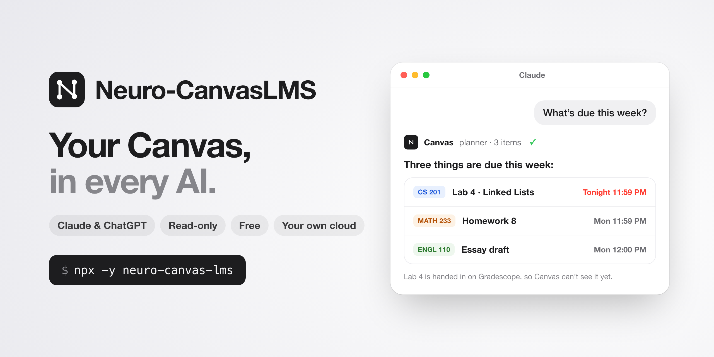

# Neuro-CanvasLMS

[English](../README.md) · [简体中文](README.zh-CN.md) · [Español](README.es.md) · [日本語](README.ja.md) · **हिन्दी**

[](https://www.npmjs.com/package/neuro-canvas-lms) [](https://github.com/BloodyReginaa/Neuro-CanvasLMS/actions/workflows/test.yml) [](https://github.com/BloodyReginaa/Neuro-CanvasLMS/blob/main/LICENSE)



**अपने Canvas LMS को सीधे Claude और ChatGPT से जोड़ें।** आपके कोर्स, समय-सीमाएँ, ग्रेड और लेक्चर फ़ाइलें अब आपके AI की जानकारी का हिस्सा हैं — किसी भी चैट में, किसी भी डिवाइस पर। यह एक केवल-पढ़ने वाला रिमोट MCP सर्वर है, जिसे एक कमांड आपके अपने मुफ़्त Cloudflare खाते में डिप्लॉय कर देता है। यह हर उस Canvas संस्थान में काम करता है जो छात्रों को एक्सेस टोकन बनाने देता है (नीचे 30 सेकंड में जाँचें)।

> "इस हफ़्ते क्या जमा करना है?" · "MATH 132 का लेक्चर 5 संक्षेप में बताओ।" · "HW 3 पर क्या फ़ीडबैक मिला?" · "लेक्चर 12 की कोड ZIP में क्या है?" · "PA2 का स्टार्टर कोड इस फ़ोल्डर में सेट कर दो।"

## Neuro-CanvasLMS क्यों

| | |
|---|---|
| ☁️ **आपके कंप्यूटर पर कुछ नहीं चलता** | यह क्लाउड में Cloudflare Workers पर चलता है। कोई ऐप खुला रखने की ज़रूरत नहीं, कोई लोकल सर्वर नहीं। |
| 🔌 **किसी डिवाइस को चालू रखने की ज़रूरत नहीं** | लैपटॉप बंद कर दें, फ़ोन जेब में रख लें — आपका AI फिर भी 24/7 Canvas तक पहुँच सकता है: claude.ai, डेस्कटॉप और मोबाइल ऐप, Claude Code या ChatGPT से। |
| 💸 **मुफ़्त** | यह Cloudflare के मुफ़्त प्लान पर चलता है, जो एक छात्र की ज़रूरत से कहीं ज़्यादा है। |
| 🧠 **फ़ाइलें बातचीत में रहती हैं** | AI जो लेक्चर नोट्स और PDF पढ़ता है, वे उस चैट के साथ आपके AI प्रदाता के सर्वर पर रहते हैं। कुछ डाउनलोड नहीं करना। |

लोकल Canvas टूल तभी काम करते हैं जब आपका कंप्यूटर उन्हें चला रहा हो। होस्टेड सेवाएँ आपका Canvas टोकन, या आपके कोर्स की कॉपी, अपने सर्वर पर रखती हैं। Neuro-CanvasLMS **आपके अपने** Cloudflare खाते में चलता है: हमेशा चालू, फ़ोन और ChatGPT में भी इस्तेमाल हो सकता है, और आपका टोकन सिर्फ़ आपके अपने Worker और आपके संस्थान के Canvas तक जाता है।

## क्या मिलता है

- **64 केवल-पढ़ने वाले टूल:** कोर्स, मॉड्यूल, पेज, फ़ाइलें, असाइनमेंट, सबमिशन, ग्रेड और फ़ीडबैक, रूब्रिक, घोषणाएँ, चर्चाएँ, इनबॉक्स, कैलेंडर, टू-डू, समूह, क्विज़ इतिहास और प्रोफ़ाइल।
- **असली फ़ाइलें पढ़ना:** PDF, Word, PowerPoint और Excel से टेक्स्ट, लगभग 90 तरह की कोड और टेक्स्ट फ़ाइलें, और Jupyter नोटबुक (सेल और आउटपुट); ZIP फ़ाइलें सर्वर पर खोली जाती हैं (सूची और हर कोड/टेक्स्ट फ़ाइल की सामग्री); स्कैन किए या हाथ से लिखे PDF पहचाने जाते हैं और मूल फ़ाइल दी जाती है, ताकि AI हर पन्ना देख सके।
- **लिंक की गई फ़ाइलें भी:** मॉड्यूल में Google Docs/Slides/Sheets, Google Drive, Dropbox फ़ाइल व फ़ोल्डर और GitHub फ़ाइल व रिपॉज़िटरी के लिंक, अगर सार्वजनिक रूप से साझा हों ("Anyone with the link"), तो टेक्स्ट के रूप में पढ़े जाते हैं।
- **कोर्स की छिपी फ़ाइलें भी मिलती हैं:** कई कोर्स छात्रों से Files सूची छिपाते हैं। कनेक्टर होम पेज, सिलेबस, मॉड्यूल, असाइनमेंट, घोषणाओं और उनसे जुड़े पेजों में खोजता है, इसलिए AI फिर भी "लेक्चर 12 की स्लाइड" नाम से ढूँढ लेता है।
- **स्टार्टर कोड सीधे आपके कंप्यूटर पर:** Claude Code, Codex और दूसरे कोडिंग एजेंट में कहें "Canvas से PA2 सेट करो"। एजेंट को एक बार चलने वाला, कुछ मिनटों में खत्म होने वाला डाउनलोड लिंक मिलता है; वह असाइनमेंट की स्टार्टर फ़ाइलें आपके फ़ोल्डर में सहेजकर खोल देता है।
- **डिज़ाइन से केवल-पढ़ना:** सिर्फ़ तय `GET` अनुरोध। यह कभी असाइनमेंट जमा नहीं करता, संदेश नहीं भेजता, क्विज़ शुरू नहीं करता और Canvas में कुछ नहीं बदलता।
- **सिर्फ़ आपका:** आपके अपने Cloudflare खाते में आपका अपना डिप्लॉयमेंट, आपके अपने Canvas खाते से बंधा हुआ। कोई और (लेखक भी) आपका Canvas टोकन कभी नहीं देखता।

## क्या आप इसे इस्तेमाल कर सकते हैं?

30 सेकंड में जाँचें: Canvas में **Account → Settings** खोलें और **Approved Integrations** तक स्क्रॉल करें। अगर **+ New Access Token** बटन दिखता है, तो आप तैयार हैं। अगर बटन नहीं है या टोकन बनाना मना हो जाता है, तो आपका संस्थान छात्रों को निजी टोकन बनाने नहीं देता, और यह कनेक्टर वहाँ अभी काम नहीं कर सकता।

## इंस्टॉल (लगभग 5 मिनट)

ज़रूरत: [Node.js 22+](https://nodejs.org), मुफ़्त [Cloudflare खाता](https://dash.cloudflare.com/sign-up) (ईमेल सत्यापित किया हुआ) और आपका Canvas लॉगिन। टर्मिनल में चलाएँ:

```bash
npx -y neuro-canvas-lms
```

इंस्टॉलर Cloudflare में साइन इन करवाता है (ब्राउज़र में पेज खुलेगा; **Authorize** पर क्लिक करें), आपके संस्थान का Canvas पता पूछता है, नया खाता हो तो आपका मुफ़्त workers.dev पता बनाता है, कनेक्टर को आपके अपने खाते में डिप्लॉय करता है और जाँचता है। नया पता ऑनलाइन होने में कुछ मिनट लग सकते हैं; इस बीच इंस्टॉलर Canvas खोल देता है ताकि आप अपना टोकन बना लें। फिर:

1. **Canvas टोकन बनाएँ (अगर अभी तक नहीं बनाया):** Canvas → Account → Settings → **+ New Access Token**। आपका संस्थान इसकी अवधि सीमित कर सकता है (UMass Amherst में 30 दिन)। तुरंत कॉपी करें — यह केवल एक बार दिखता है।
2. **Claude:** Settings → Connectors → **Add custom connector** → इंस्टॉलर द्वारा दिखाया गया URL चिपकाएँ (पहले से कॉपी है) → **Connect** → Canvas टोकन चिपकाएँ → Authorize। यह मोबाइल ऐप और Claude Code समेत हर जगह काम करता है।
3. **ChatGPT:** डेवलपर मोड में उसी URL से कस्टम कनेक्टर जोड़ें।
4. नई चैट में पूछें: "इस हफ़्ते मेरे कौन-से असाइनमेंट हैं?"

**AI से इंस्टॉल करवाएँ:** टर्मिनल कमांड चला सकने वाले किसी भी AI सहायक (Claude Code, Codex आदि) को इस रिपॉज़िटरी का लिंक दें और कहें "Canvas कनेक्टर इंस्टॉल करो"। क्लोन करने की ज़रूरत नहीं। **AI एजेंट: [`SKILL.md`](../.claude/skills/canvas-connector-setup/SKILL.md) का पालन करें**: विकल्पों के साथ एक ही `npx` कमांड, और Canvas टोकन कभी आपके हाथ में नहीं आता।

**Canvas टोकन समाप्त होने पर:** नया टोकन बनाएँ, AI ऐप में कनेक्टर को Disconnect → Connect करें और चिपकाएँ। दोबारा इंस्टॉल करने की ज़रूरत नहीं।

## अपडेट, अनइंस्टॉल

- **अपडेट:** वही `npx` कमांड फिर से चलाएँ। यह एक बार पूछता है कि अपडेट करना है या नहीं (y लिखें), फिर आपकी सहेजी गई सेटिंग्स इस्तेमाल करता है, मौजूदा कोड डिप्लॉय करता है और आपका स्टोरेज व कनेक्शन बनाए रखता है; दोबारा जोड़ने की ज़रूरत नहीं। नया संस्करण आने पर आपका AI आपको बता देगा। अपडेट के बाद, नई सुविधाएँ देखने के लिए ChatGPT में सेटिंग्स से इस कनेक्टर को Refresh करें; Claude में नई चैट शुरू करें।
- **अनइंस्टॉल:** `npx -y neuro-canvas-lms uninstall`, फिर Canvas टोकन और AI ऐप में कनेक्टर हटाएँ।

## यह कैसे काम करता है

```
Claude / ChatGPT ──OAuth──▶ आपके Cloudflare पर Neuro-CanvasLMS ──केवल-पढ़ने वाला API──▶ आपके संस्थान का Canvas
 (कोई भी डिवाइस)             (हमेशा चालू; आपका Canvas टोकन एन्क्रिप्ट करके रखता है)
```

## गोपनीयता और सुरक्षा

- टोकन केवल आपके Worker और आपके संस्थान के Canvas को जाता है, और आपके अपने Cloudflare KV में ऑथराइज़ेशन रिकॉर्ड के अंदर एन्क्रिप्ट होकर रहता है।
- कनेक्टर जोड़ते समय आपके Canvas खाते से बंध जाता है; बाकी खाते अस्वीकार होते हैं।
- केवल Claude, ChatGPT और लोकल क्लाइंट OAuth पूरा कर सकते हैं।
- कोर्स सामग्री को अविश्वसनीय डेटा माना जाता है, निर्देश नहीं।
- डाउनलोड की सीमा 15 MiB है, केवल HTTPS, और निजी नेटवर्क से अवरुद्ध।
- Canvas आपकी अपनी अनुमतियाँ लागू करता है — आप वही पढ़ सकते हैं जो पहले से देख सकते हैं।
- दिन में एक बार कनेक्टर npm (जहाँ यह प्रकाशित होता है) से नवीनतम संस्करण संख्या पढ़ता है, ताकि आपका AI आपको अपडेट के बारे में बता सके। आपके बारे में कुछ भी नहीं भेजा जाता।
- AI जो फ़ाइलें पढ़ता है, उन्हें आपका AI प्रदाता बातचीत के हिस्से के रूप में अपनी गोपनीयता शर्तों के तहत रखता है। चैट हटाने पर वे हट जाती हैं।

इस्तेमाल से पहले व्यक्तिगत टोकन और थर्ड-पार्टी टूल पर अपने संस्थान की नीति देखें।

## सीमाएँ

- 15 MiB से बड़ी फ़ाइलें कनेक्टर से नहीं पढ़ी जा सकतीं (Cloudflare Worker मेमोरी सीमा); उन्हें डाउनलोड करके लोकल Claude Code से खोलें।
- Gradescope, WebAssign, बाहरी साइटें, लॉक सामग्री और New Quizzes का आंतरिक डेटा पहुँच से बाहर है।
- कुछ कोर्स Files/Quizzes पेज छिपाते हैं (403/404)। कोर्स में कहीं भी जुड़ी फ़ाइलें फिर भी मिल जाती हैं (ऊपर देखें); क्विज़ छिपे ही रहते हैं।
- UMass Amherst के Canvas (Instructure द्वारा होस्ट) पर परखा गया। दूसरे संस्थानों में भी चलना चाहिए; जो संस्थान Canvas खुद होस्ट करते हैं, वे ऐसे सर्वर से फ़ाइलें दे सकते हैं जिन्हें कनेक्टर अभी अनुमति नहीं देता।

## प्रोजेक्ट की स्थिति

MIT लाइसेंस वाला सामुदायिक प्रोजेक्ट, **जैसा है वैसा प्रदान किया गया**: रखरखाव, अपडेट या सहायता की कोई गारंटी नहीं। Issues, pull requests और forks का स्वागत है। अगर यह आपके संस्थान में काम करना बंद कर दे, तो कोड यहीं है — आप उसे ठीक कर सकते हैं। आप issue भी खोल सकते हैं; लेखक उसे ठीक करने की व्यवस्था करेगा।

## डेवलपमेंट

`npm test` · `npm run check` (ट्रायल बिल्ड) · `npm run setup` (क्लोन से इंस्टॉलर)। UI टेक्स्ट `i18n.mjs` में है (English, 简体中文, Español, 日本語, हिन्दी)। कोड का नक्शा [`AGENTS.md`](../AGENTS.md) में। AI कोडिंग सहायकों की मदद से बनाया गया।
