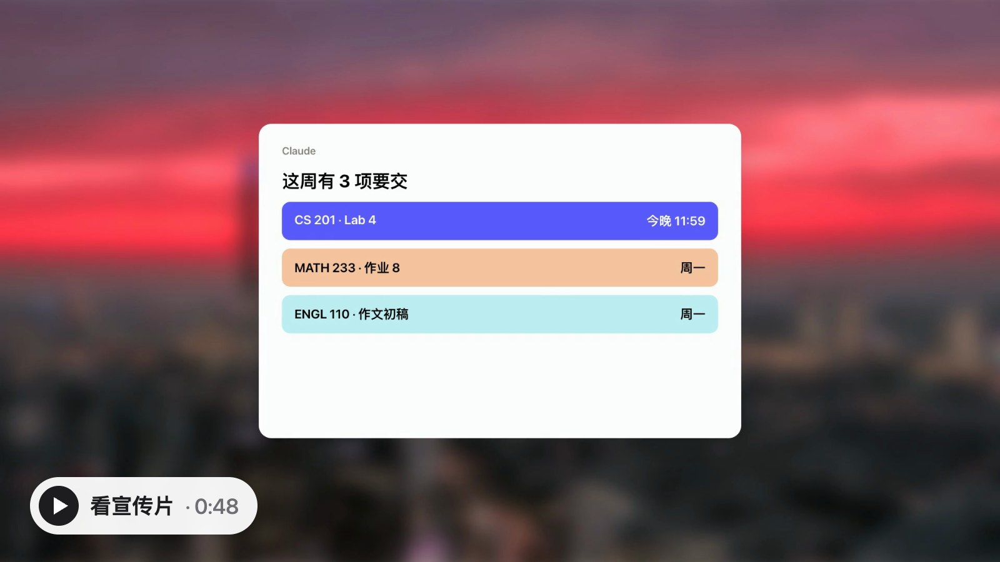

# Neuro-CanvasLMS

[English](../README.md) · **简体中文** · [Español](README.es.md) · [日本語](README.ja.md) · [हिन्दी](README.hi.md)

[](https://www.npmjs.com/package/neuro-canvas-lms) [](https://github.com/BloodyReginaa/Neuro-CanvasLMS/actions/workflows/test.yml) [](https://github.com/BloodyReginaa/Neuro-CanvasLMS/blob/main/LICENSE)

[](https://bloodyreginaa.github.io/Neuro-CanvasLMS/promo-zh.mp4)

**把你的 Canvas 直接接进 Claude 和 ChatGPT。** 课程、截止日期、成绩、讲义，从此都在 AI 的掌握之中，任何对话、任何设备都能用。它是一个只读的远程 MCP 服务器，一条命令就能部署到你自己的免费 Cloudflare 账号。只要学校允许学生生成 Canvas 访问令牌就能用（下面有 30 秒自查）。

> "这周有什么要交？" · "总结一下 MATH 132 的 Lecture 5。" · "HW 3 老师给了什么评语？" · "第 12 讲的代码压缩包里有什么？" · "把 PA2 的 starter code 下到这个文件夹并搭好。"

## 为什么选 Neuro-CanvasLMS

| | |
|---|---|
| ☁️ **不用在本地运行** | 跑在云端的 Cloudflare Workers 上。不用开着任何程序，没有本地服务器。 |
| 🔌 **不需要任何设备一直开着** | 合上电脑、手机揣兜里都没关系，AI 随时都能连上 Canvas，在 claude.ai 网页、桌面版、手机 App、Claude Code、ChatGPT 里都能用。 |
| 💸 **免费** | 用的是 Cloudflare 免费套餐，个人使用远远用不完。 |
| 🧠 **文件留在对话里** | AI 读过的讲义和 PDF 会随对话保存在 AI 服务商的服务器上，不用下载。 |

本地工具只有在你的电脑开着、程序在跑时才能用；托管服务会把你的 Canvas 令牌或课程副本存在它们的服务器上。Neuro-CanvasLMS 跑在**你自己的** Cloudflare 账号里：随时在线，手机和 ChatGPT 也能用，令牌只会发给你自己的 Worker 和学校的 Canvas。

## 功能

- **65 个只读工具：** 课程、模块、页面、文件、作业、提交记录、成绩与评语、评分标准、公告、讨论区、站内信、日历、待办、小组、测验记录、个人设置。
- **真正能读文件：** 提取 PDF、Word、PPT、Excel 的文字，约 90 种代码和文本文件，Jupyter 笔记本（代码单元和输出）；zip 压缩包在服务器端解压（给出目录和每个代码/文本文件的内容）；能认出手写或扫描的 PDF，并提供原始文件让 AI 逐页看图。
- **外链的文件也能读：** 模块、教学大纲、页面、作业或公告里链接到 Google 文档/幻灯片/表格、Google Drive、Dropbox 文件和文件夹、GitHub 文件和仓库的课件，只要是公开分享的（"知道链接的任何人"），都能直接读出文字。
- **课程藏起来的文件也能找到：** 很多课程不给学生看"文件"列表。连接器会在主页、教学大纲、模块、作业、公告和它们链接的页面里找，所以 AI 照样能按名字找到"第 12 讲的课件"。
- **starter code 直接下到电脑上：** 在 Claude Code、Codex 等编程 AI 里说"从 Canvas 把 PA2 搭好"，AI 会拿到一个只能用一次、几分钟就过期的下载链接，把作业的 starter 文件存进你的文件夹并解压。
- **设计上就是只读：** 全部是固定的 `GET` 请求。不会提交作业、发消息、开始测验，也不会修改 Canvas 中的任何内容。
- **只属于你：** 部署在你自己的 Cloudflare 账号里，锁定你自己的 Canvas 账号。任何其他人（包括作者）都看不到你的 Canvas 令牌。

## 能不能用？

30 秒自查：在 Canvas 里打开 **账户 → 设置**，往下翻到 **已批准的集成**（Approved Integrations）。看到 **+ 新建访问许可证**（+ New Access Token）按钮就能用。如果没有这个按钮，或者生成时被拒绝，说明学校不允许学生生成个人令牌，这个连接器暂时没法在你的学校用。

## 安装（约 5 分钟）

你需要：[Node.js 22+](https://nodejs.org)、免费的 [Cloudflare 账号](https://dash.cloudflare.com/sign-up)（注册后先验证邮箱），以及能登录 Canvas。在终端里运行：

```bash
npx -y neuro-canvas-lms
```

安装向导会：登录 Cloudflare（浏览器会打开一个页面，点 **Authorize**）、问你学校的 Canvas 网址、新账号自动开通免费的 workers.dev 地址、部署到你自己的账号、检查是否正常。新地址第一次上线可能要几分钟，向导会趁这段时间打开 Canvas，让你先生成令牌。然后：

1. **生成 Canvas 令牌（如果还没生成）：** Canvas → 账户 → 设置 → **+ 新建访问许可证**。学校可能限制有效期（UMass Amherst 最长 30 天）。立刻复制，Canvas 只显示一次。
2. **Claude：** 设置 → 连接器 → **添加自定义连接器** → 粘贴向导打印出来的网址（已经自动复制了）→ **连接** → 粘贴 Canvas 令牌 → 授权。之后在任何地方用 Claude 都能用，包括手机 App 和 Claude Code。
3. **ChatGPT：** 在开发者模式里用同一个网址添加自定义连接器。
4. 新开一个对话，问："我这周有哪些作业？"

**让 AI 帮你装：** 把这个仓库的链接发给任何能运行终端命令的 AI 助手（Claude Code、Codex 等），说"帮我安装 Canvas 连接器"。不需要克隆仓库。**AI 助手请按照 [`SKILL.md`](../.claude/skills/canvas-connector-setup/SKILL.md) 操作**：一条带参数的 `npx` 命令就能装好，全程不碰 Canvas 令牌。

**Canvas 令牌过期后：** 生成一个新令牌，在 AI 应用里把连接器"断开 → 重新连接"并粘贴即可，不需要重装。

## 更新、卸载

- **更新：** 再运行一次同样的 `npx` 命令。它会先问一次要不要更新（输入 y），然后沿用之前的设置，部署当前的代码，存储和连接都会保留，不需要重新连接。有新版本时，AI 会告诉你。更新后，ChatGPT 要在设置里把这个连接器刷新一下才能用上新功能；Claude 新开一个对话就行。
- **卸载：** `npx -y neuro-canvas-lms uninstall`，然后删掉 Canvas 令牌和 AI 应用里的连接器。

## 原理

```
Claude / ChatGPT ──OAuth──▶ 你 Cloudflare 上的 Neuro-CanvasLMS ──只读 API──▶ 你学校的 Canvas
  （任何设备）                （始终在线，加密保存你的 Canvas 令牌）
```

## 隐私与安全

- 令牌只会发送到你的 Worker 和学校的 Canvas，并加密保存在你自己 Cloudflare KV 的授权记录里。
- 连接器在你连接时锁定到你的 Canvas 账号，其他账号一律拒绝。
- 只有 Claude、ChatGPT 和本地客户端可以完成 OAuth 授权。
- 课程内容一律视为不可信数据，不会被当作指令执行。
- 文件下载上限 15 MiB，仅限 HTTPS，并禁止访问内网地址。
- Canvas 依然执行你本人的权限：你只能读到自己本来就能看到的内容。
- 连接器每天从 npm（它发布的地方）读一次最新版本号，用来让 AI 提醒你更新。不会发送任何关于你的信息。
- AI 读过的文件由 AI 服务商作为对话的一部分保存，适用该服务商自己的隐私条款；删除对话即可删除。

使用前请确认你所在学校关于个人访问令牌和第三方工具的规定。

## 限制

- 超过 15 MiB 的文件无法通过连接器读取（受 Cloudflare Worker 内存限制）。请下载后用本地的 Claude Code 打开。
- Gradescope、WebAssign、外部网站、锁定内容和 New Quizzes 内部数据无法读取。
- 有些课程隐藏了"文件/测验"页面（403/404）。课程里任何地方链接的文件仍然能找到（见上文）；测验仍然看不到。
- 在 UMass Amherst 的 Canvas（由 Instructure 托管）上测试过。其他学校应该也能用；自己托管 Canvas 的学校，文件可能放在连接器暂不允许的服务器上。

## 项目状态

社区项目，MIT 许可证，**按原样提供**：不保证维护、更新或技术支持。欢迎提 issue、提交代码，也欢迎 fork。如果它在你的学校不能用了，代码就在这里，可以自己修。当然也可以提交issue，作者安排修复。

## 开发

`npm test` · `npm run check`（试构建）· `npm run setup`（从克隆的仓库运行安装向导）。界面文字在 `i18n.mjs`（English、简体中文、Español、日本語、हिन्दी）。代码结构见 [`AGENTS.md`](../AGENTS.md)。在 AI 编程助手的帮助下开发。
